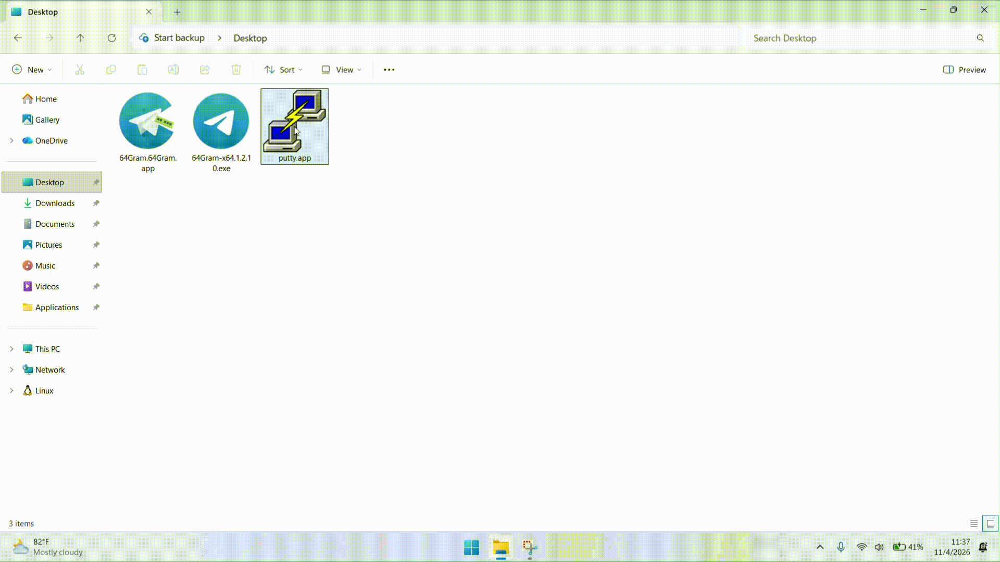

# DropIn

Drag and Drop software installation gimmick for Windows. The **Packager** turns a winget or Chocolatey package into a single `.app` file. The **Installer** installs it with one click, a drag, or by dropping the file into an install directory.

## Demo

**Packager**


**Installer**



## Credits

Icons and screenshots come from the community database of [UniGetUI](https://github.com/Devolutions/UniGetUI) ([WebBasedData](https://github.com/Devolutions/UniGetUI/tree/main/WebBasedData)), which is also the inspiration for this project. Package metadata comes from winget and Chocolatey.

## How it works

1. The Packager searches for a package, downloads its installer (checksum verified) and writes `<id>.app` (a ZIP with `manifest.json`, icon and screenshots).
2. The Installer installs the `.app` or a raw installer silently, then opens the result folder or offers to run its `.exe`.

Supported files: `.app`, `.exe`, `.msi`, `.msix`, `.msixbundle`, `.appx`, `.appxbundle`, `.zip`.

## Programs (`src/`)

Run `.\build-release.ps1` in PowerShell to build Release binaries. Output is written to `build\Release`. The build sets program version `1.0.0` and copyright `2026 Sidik hadi Kurniadi`. To build another configuration, run `dotnet build src\DropIn.slnx --configuration Debug`.

### DropIn.Packager

- **Search**: pick a source (winget / chocolatey), search by name or id, or paste a whole command such as `winget install --id Git.Git -a x86` or `choco install 7zip --version 23.1`.
- **Installer options**: filters (architecture, installer/portable, type, scope, locale) come from the manifest. Every property of the selected installer is editable in a grid (e.g. `Switches.Silent`, `InstallerUrl`).
- **Icon and screenshots**: filled from the UniGetUI database (or the package itself) and replaceable with a path or URL. Separate several screenshots with `;`. The database is downloaded on first launch. Refresh it with **Database > Update icon and screenshot database**. Failures (for example a blocked host) are explained in the log.
- **Custom database**: `Database\custom-database.json` is never overwritten, takes priority, and may use local image paths.

CLI:

```
DropIn.Packager -p "winget install --id Git.Git" -p "choco install 7zip"
DropIn.Packager -p winget Git.Git -p choco 7zip
DropIn.Packager -p 7zip -p putty --source chocolatey
DropIn.Packager <winget|choco> <package-id> [version] [-o dir]

# Unattended, custom output folder
DropIn.Packager -p Git.Git -y -o D:\Apps
```

| Option | Description |
|---|---|
| `-p`, `--package <command-or-id>` | Package to build. Also `--package <winget\|choco\|chocolatey> <id>` |
| `--source <winget\|choco\|chocolatey>` | Source for inputs without one (default `winget`) |
| `-o`, `--output <dir>` | Output folder |
| `-y`, `--yes` | Don't prompt: use the latest (or requested) version and the preferred installer option |
| `--interactive` | Prompt for version and installer option (default, unless input is redirected) |
| `--no-unigetui` | Skip the UniGetUI icon and screenshot database |
| `-h`, `--help` | Show usage (must be the first argument) |

Default preferences live in `Packager.PreferredInstaller`.

### DropIn.Installer

Ways to install:

1. **Drop** supported files onto the Installer window, or use its install button.
2. **Drop** supported files into `InstallDirectory`.
3. **Default handler**: opening an `.app` installs it immediately.

Behavior:

- Each package gets the folder `InstallSubfolderPattern` (default `<InstallDirectory>\<Source>\<Name>`. Raw installers use source `other`, e.g. `other\winbox`).
- The setup type is recognized (Inno Setup, NSIS, WiX Burn) so the right silent and target-folder switches are used. If they fail, the other known silent switches are tried before the interactive fallback (`SilentInstall.Fallback`).
- Portable apps are extracted to the install folder and can get a Start Menu item (`PortableAppStartMenuItem`). Setup-type packages are left as their setup makes them.
- The service never installs as SYSTEM: setups run as the logged-on user and ask for elevation when required.
- When the installer window opens and the handler or service is missing, the Installer tries to register them (a UAC prompt appears). The **Setup** menu switches between Register and Unregister.

CLI:

| Command | Description |
|---|---|
| `DropIn.Installer <file> ...` | Install the given files |
| `--install [file ...]` | Browse for files, or install the given files |
| `--register` | Register the `.app` handler and the watcher service (needs administrator) |
| `--unregister` | Remove both (needs administrator) |
| `-h`, `--help` | Show usage (printed to the console, or in a message box without one) |

## Configuration

Both programs share one `dropin.config.json` in the program folder.

- Created with defaults when missing and new options are added automatically.
- Relative paths resolve against the program folder. If a folder is not writable, the programs offer to restart as administrator.
- An empty `Log.File` disables that log. `Log.Level` is `Error`, `Warning`, `Info` or `Debug`.

### `Installer`

| Key | Default | Description |
|---|---|---|
| `AfterInstall` | `AskRunSingleExe` | `AskRunSingleExe`, `OpenFolder`, `RunSingleExe` or `None` |
| `InstallDirectory` | `Applications` | Install and watch folder |
| `InstallSubfolderPattern` | `{Source}\{Name}` | Subfolder. Tokens `{Name}`, `{Version}`, `{Source}` (`winget`, `chocolatey`, `other`) |
| `OverwriteExisting` | `true` | Overwrite an existing install folder: `true`, `false`, `"Ask"` |
| `PortableAppStartMenuItem` | `true` | Start Menu item for portable/zip apps only |

### `Installer.Log`

| Key | Default | Description |
|---|---|---|
| `File` | `Logs\Installer.log` | Log file |
| `Level` | `Info` | Log level |

### `Installer.Progress`

| Key | Default | Description |
|---|---|---|
| `AutoClose` | `true` | Close the window after a successful install |
| `Show` | `true` | Show the progress window |

### `Installer.Screenshots`

| Key | Default | Description |
|---|---|---|
| `Show` | `true` | Show package screenshots |
| `Slideshow` | `Loop` | `Loop`, `UntilFinished` or `Off` |
| `SlideshowSeconds` | `4` | Seconds per screenshot (1-60) |

### `Installer.SilentInstall`

| Key | Default | Description |
|---|---|---|
| `ExtraSwitches` | `{}` | Extra silent switches per package name, e.g. `{ "Git": "/COMPONENTS=icons" }` |
| `Fallback` | `true` | Open the installer interactively if silent install fails |
| `TimeoutMinutes` | `0` | Stop a silent installer after N minutes (0 = no limit) |

### `Installer.Upgrade`

| Key | Default | Description |
|---|---|---|
| `MsiCleanUpgrade` | `true` | Uninstall the old MSI product before installing |
| `RemoveOldVersions` | `true` | Remove older versions of the same package: `true`, `false`, `"Ask"` |

### `Packager`

| Key | Default | Description |
|---|---|---|
| `OutputNamePattern` | `{Id}` | Output file name. Tokens `{Id}`, `{Version}`, `{Source}` |
| `OverwriteOutput` | `true` | Overwrite an existing `.app` |
| `PackageOutputDirectory` | `Packages` | Output folder |
| `SearchResultLimit` | `100` | Maximum search results (1-1000) |
| `UnknownInstallerType` | `zip` | Type assumed when it cannot be detected |
| `WarnInstallerTraces` | `true` | Warn when the installer looks like it contains personal traces |

### `Packager.Database`

| Key | Default | Description |
|---|---|---|
| `AutoUpdate` | `true` | Update the database automatically when `UpdateIntervalDays` has passed |
| `Directory` | `Database` | Database folder |
| `LastUpdate` | `null` | Time of the last update |
| `UpdateIntervalDays` | `30` | Days between automatic updates |

### `Packager.Downloads`

| Key | Default | Description |
|---|---|---|
| `Directory` | `Downloads` | Folder for kept installers |
| `KeepInstallers` | `false` | Keep downloaded installers |
| `VerifyChecksum` | `true` | Verify download checksums |

### `Packager.Log`

| Key | Default | Description |
|---|---|---|
| `File` | `Logs\Packager.log` | Log file |
| `Level` | `Info` | Log level |

### `Packager.Network`

| Key | Default | Description |
|---|---|---|
| `AllowInvalidCertificates` | `false` | UNSAFE: accept invalid TLS certificates for all DropIn downloads (installers, images, database). Enable only on a trusted network |
| `DownloadRetries` | `4` | Retries per download (1-10) |
| `MaxParallelDownloads` | `4` | Parallel connections per download (1-16) |
| `ProxyUrl` | `""` | Proxy URL |
| `UserAgent` | `DropIn-Packager/1.0` | HTTP user agent |

### `Packager.PortableClient`

| Key | Default | Description |
|---|---|---|
| `Directory` | `PortableClient` | Portable winget/choco folder |
| `Prefer` | `false` | Prefer the portable client over an installed one |

### `Packager.PreferredInstaller`

| Key | Default | Description |
|---|---|---|
| `Architecture` | `x64` | Preferred architecture |
| `Kind` | `portable` | `portable` or `installer` |
| `Type` | `exe` | Preferred installer type |

### `Packager.State`

| Key | Default | Description |
|---|---|---|
| `LastInput` | `""` | Last input |
| `LastSource` | `winget` | Last selected source |
| `WindowHeight` | `0` | Saved window height |
| `WindowWidth` | `0` | Saved window width |

## License

MIT, see [LICENSE](LICENSE).
