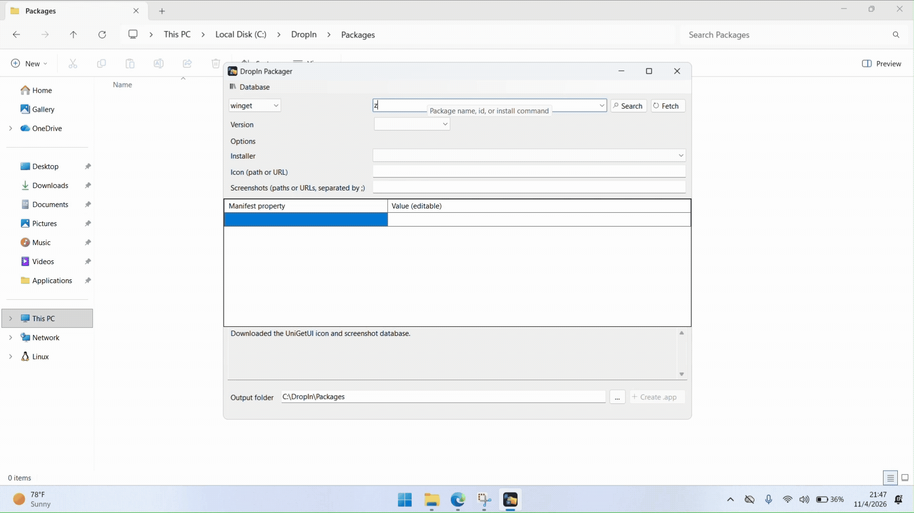

# DropIn

DropIn is a Windows application for packaging and installing software with drag and drop. The **Packager** creates `.app` packages from winget or Chocolatey. The **Installer** installs them or supported installer files.

## Getting started

1. Install the matching-architecture [.NET 8 Desktop Runtime](https://dotnet.microsoft.com/download/dotnet/8.0).
2. Run the DropIn setup for your Windows architecture.
3. Use the Packager to create a package, then open or drag it to the Installer.

See the **[usage guide](docs/USAGE.md)** for supported file types and links to the [programs guide](docs/PROGRAMS.md) and [configuration reference](docs/CONFIGURATION.md).

## Demo

**Packager**

**Installer**

## Credits and license

DropIn uses package metadata from winget and Chocolatey. Icons and screenshots come from the [UniGetUI community database](https://github.com/Devolutions/UniGetUI/tree/main/WebBasedData), which also inspired this project.

MIT license. See [LICENSE](LICENSE).
